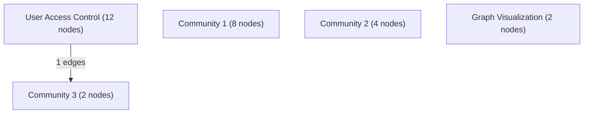

# Knowledge Graph Index

> Auto-generated by graphify. Start here — read community articles for context, then drill into god nodes for detail.

**28 nodes · 24 edges · 5 communities**

---

## System Architecture Flowchart

## Communities
(sorted by size, largest first)

- [[User Access Control]] — 12 nodes
- [[Community 1]] — 8 nodes
- [[Community 2]] — 4 nodes
- [[Community 3]] — 2 nodes
- [[Graph Visualization]] — 2 nodes

## God Nodes
(most connected concepts — the load-bearing abstractions)

- [[15 Oktober 2026 — Akses lintas perangkat dan backup proyek]] — 12 connections
- [[Administrasi Memo UTP]] — 7 connections
- [[Riwayat Percakapan Codex — UTP Memo Cloud App]] — 2 connections
- [[Codex]] — 1 connections
- [[Codex]] — 1 connections
- [[Codex]] — 1 connections
- [[Codex]] — 1 connections
- [[Codex]] — 1 connections
- [[Pengguna]] — 1 connections
- [[Pengguna]] — 1 connections

---

*Generated by [graphify](https://github.com/safishamsi/graphify)*